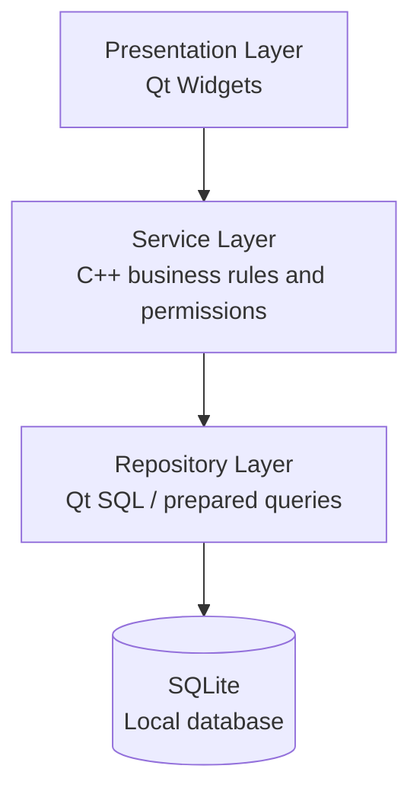
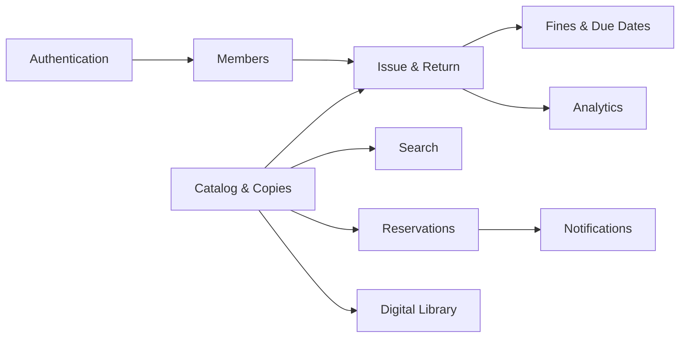
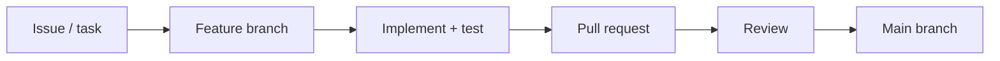

<div align="center">

# 📚 Smart Library Book Tracker

### A C++ and Qt desktop application for university library management and digital reading


[Overview](#-overview) · [Features](#-planned-features) · [Architecture](#-architecture) · [Database](#-database-design) · [Workflow](#-team-workflow) · [Roadmap](#-roadmap)

</div>

---

## 📖 Overview

**Smart Library Book Tracker** is a **C++17 desktop application** built with **Qt 6 Widgets** to streamline university library operations and provide a digital reading experience. The planned system brings together physical book inventory, borrowing and returns, reservations, due-date and fine tracking, student management, and an administrator-curated digital library.

The **initial release targets one university**. A broader multi-university deployment is a potential future extension, not a current capability.

> 🚧 **Project status:** Planning / under development. Features described below are **planned requirements**, not claims that they have already been implemented.

## 🎯 Goals

- Make book discovery and availability tracking easier for students and librarians.
- Reduce manual effort in issuing, returning, and reserving physical books.
- Keep accurate borrowing histories, due dates, and fine records.
- Offer authorized digital reading through a graphical PDF viewer.
- Separate private university library information from public digital content.
- Build maintainable C++ software with clear module boundaries and collaborative Git workflows.

## ✨ Planned Features

| Area | Features |
|---|---|
| 🔐 Authentication & roles | Login, student/faculty/librarian/admin accounts, access restrictions |
| 📚 Book catalog | Add/edit/archive titles, authors, categories, ISBN, departments, shelf locations |
| 🔢 Physical copies | Track individual copies and available/borrowed/reserved quantities |
| 🔎 Smart search | Search by title, author, ISBN, category, department, subject, and language |
| 🔄 Issue & return | Borrowing records, return processing, lending limits |
| 📅 Due dates & fines | Configurable loan periods, overdue detection, fine calculation |
| 📌 Reservations | Waiting lists and reservation status for unavailable books |
| 🎓 Semester pre-booking | Advance requests for upcoming courses and semesters |
| 👥 Member management | University member profiles and borrowing history |
| 📖 Digital library | Admin-managed PDFs, authorized reading/downloads, reading progress |
| ⭐ Discovery | Ratings, reviews, featured books, top-ten recommendations, wishlists |
| 💎 Membership | University-configurable 30-day and semester-based borrowing plans |
| 🔔 Notifications | Due dates, reservation updates, announcements |
| 📊 Analytics | Most-borrowed books, circulation statistics, overdue summaries |
| 💬 Feedback | Complaint submission and tracking |
| 🌗 Preferences | Dark/light theme and planned Bangla/English interface |

### 🔒 Access model

| Role | Physical university library | Public digital library | Administration |
|---|---|---|---|
| Super Admin | Authorized access | Yes | System-wide |
| University Admin | Authorized access | Yes | University settings and catalog |
| Librarian | Manage circulation | Yes | Assigned library operations |
| University Student | Search, borrow, reserve | Yes | No |
| Faculty Member | Search, borrow, reserve | Yes | No |
| Public Reader / External Student | **No access to private physical catalog or counts** | Yes | No |

Access restrictions must be enforced in the **service and data-access layers**, not merely by hiding buttons. Digital files may only be distributed where copyright and licensing permit.

## 🛠️ Technology Stack

| Technology | Purpose |
|---|---|
| **C++17** | Application and business logic |
| **Qt 6 Widgets** | Desktop graphical user interface |
| **Qt Designer / Qt Creator** | UI design and development |
| **Qt SQL** | Database connectivity |
| **SQLite** | Local prototype database |
| **Qt PDF** | Planned PDF viewing component |
| **QDate / QDateTime** | Borrowing dates, deadlines, and fine logic |
| **QPainter** | Optional custom charts and visualizations |
| **CMake** | Build configuration |
| **Git & GitHub** | Version control and team collaboration |

**Course constraint:** Core application development uses **C++ and a GUI**. Third-party modules are subject to instructor approval.

**Deployment note:** SQLite supports a local desktop prototype. Reliable concurrent access from multiple university computers, external readers, and centralized accounts would require a **future C++ service/backend and shared database**, plus appropriate networking and security. Those capabilities are **not provided by a standalone local SQLite file**.

## 🏛️ Architecture

The project is designed around a layered structure:



| Layer | Responsibility | Avoid |
|---|---|---|
| Presentation | Screens, forms, navigation, validation feedback | Direct SQL queries |
| Services | Circulation rules, reservations, fines, authorization | GUI-specific logic |
| Repositories | Database reads/writes and transactions | Business rules |
| Database | Persistence, keys, constraints | GUI state |

### 🧩 Planned modules



## 📂 Proposed Project Structure

> This is a **target layout**, not a statement about files currently present in the repository. Align it with the team's approved structure before implementing modules.

```text
Smart-Library-Book-Tracker/
├── CMakeLists.txt
├── README.md
├── docs/
│   ├── requirements/
│   ├── architecture/
│   ├── database/
│   └── testing/
├── src/
│   ├── main.cpp
│   ├── core/
│   ├── models/
│   ├── services/
│   ├── repositories/
│   ├── database/
│   ├── ui/
│   └── utils/
├── include/
├── forms/                 # Qt Designer .ui files
├── resources/
│   ├── icons/
│   ├── images/
│   └── themes/
├── database/
│   ├── migrations/
│   └── seed/
└── tests/
```

## 💾 Database Design

The initial database is planned for **SQLite**, accessed through **Qt SQL** with parameterized queries. Enable foreign-key enforcement on every database connection and use transactions for multi-step circulation operations.

| Proposed table | Purpose |
|---|---|
| `users`, `roles` | Accounts and role assignments |
| `university_members` | Student/faculty affiliations |
| `books`, `authors`, `book_authors` | Bibliographic information |
| `book_copies` | Individual physical copies and status |
| `categories`, `departments` | Classification and search |
| `borrow_records` | Issues, due dates, returns |
| `reservations`, `prebookings` | Queues and advance requests |
| `digital_books` | Authorized digital files and access rules |
| `reading_progress`, `reviews` | Digital reading and feedback |
| `membership_plans`, `subscriptions` | Configurable membership rules |
| `fines`, `payments` | Charges and payment records |
| `notifications`, `complaints` | Alerts and support tickets |
| `audit_logs` | Sensitive administrative actions |

The schema is **proposed** and should be reviewed before implementation. Store password hashes using an appropriate approved password-hashing solution; never store plaintext passwords.

## 👥 Team Responsibilities

Assignments are **to be confirmed** by the project team.

| Module | Owner | Status |
|---|---|---|
| Architecture & integration | TBD | Not started |
| Authentication & members | TBD | Not started |
| Catalog, copies & search | TBD | Not started |
| Borrowing, fines & reservations | TBD | Not started |
| Digital library & reader | TBD | Not started |
| Dashboard, analytics & testing | TBD | Not started |

Each module owner should document public class interfaces, affected database tables, tests, and integration dependencies.

## 🌿 Team Workflow



1. Create a GitHub Issue or agreed task before development.
2. Branch from the latest shared base: `feature/<short-task-name>`.
3. Keep changes scoped to the assigned module and follow agreed interfaces.
4. Open a Pull Request describing changes, dependencies, and testing.
5. Merge only after review and integration checks; keep `main` stable.

**Shared decisions:** Changes to the database schema, CMake configuration, common models, and cross-module interfaces should be approved by the team before merging.

## 🚀 Getting Started

### Prerequisites

- C++17-capable compiler (for example, MSVC or MinGW on Windows)
- Qt 6 with **Widgets** and **SQL** modules
- Qt Creator (recommended)
- CMake and Git
- Qt PDF module if working on the digital reader

### Build and run

> ⚠️ Build commands will be documented after the initial `CMakeLists.txt` and application entry point are committed and verified. The README does not claim the application is currently buildable.

Once the repository has an approved build configuration, contributors should follow the project-specific setup instructions maintained here.

## 🧪 Testing Plan

- **Unit tests:** Fine calculation, loan duration, availability rules, and validation.
- **Database tests:** CRUD, foreign keys, transactions, and rollback behavior.
- **Authorization tests:** Ensure public readers cannot access private physical-library records.
- **GUI tests:** Navigation, invalid inputs, empty states, and PDF-reader errors.
- **Integration tests:** Issue → return, reservation → fulfillment, and membership policy changes.

Automated tests are **planned**, not yet claimed as implemented.

## 🗺️ Roadmap

- [ ] Agree on requirements, roles, and architecture
- [ ] Initialize Qt/CMake application skeleton
- [ ] Approve database schema and migrations
- [ ] Implement authentication and role checks
- [ ] Implement catalog, copy inventory, and search
- [ ] Implement issuing, returns, and due dates
- [ ] Implement fines and reservation queues
- [ ] Implement semester pre-booking
- [ ] Implement digital book catalog and PDF reader
- [ ] Add ratings, reviews, and reading progress
- [ ] Add membership policies, notifications, and analytics
- [ ] Add feedback, accessibility, and localization
- [ ] Run security, integration, and usability tests
- [ ] Package first desktop MVP
- [ ] Evaluate centralized deployment architecture

## ⚖️ Digital Content Policy

Only authorized administrators may add digital books. Each uploaded file must have a valid license or other permission for its intended use. Online reading and downloads must respect the recorded access rights. The application should not assume that possession of a PDF grants redistribution rights.

## 📌 Project Status

🚧 **Under development.** This document describes the planned product and team architecture. Actual progress should be reflected in commits, Issues, and Pull Requests.

## 🎓 Academic & Product Vision

Smart Library Book Tracker begins as a university C++/GUI team project, with the longer-term ambition of becoming a maintainable real-world library software product. Its first target is a **single university**, with future multi-university support considered only after the initial system is stable.

## 📄 License

**To be decided.** No open-source license is implied until the team adds an explicit `LICENSE` file.
