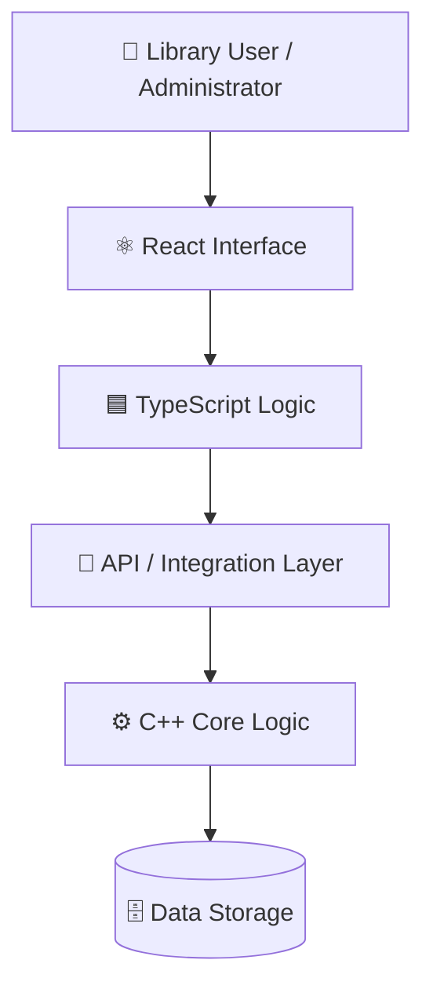
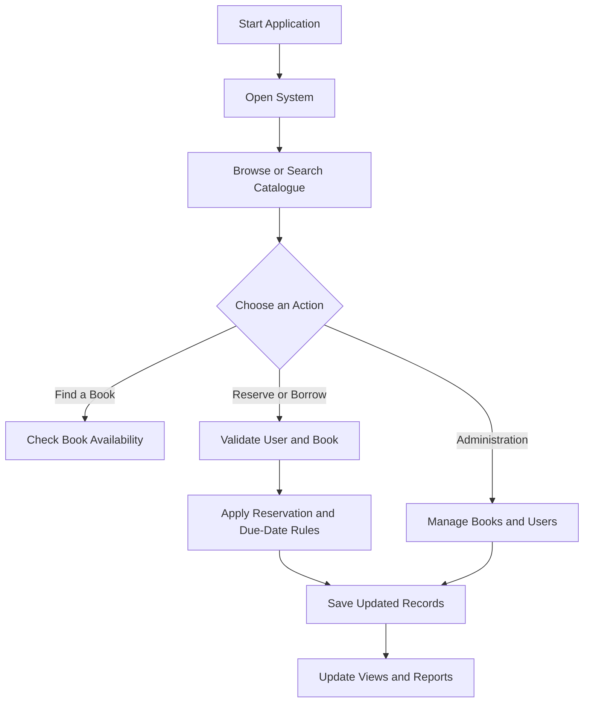

<div align="center">

# 📚 Smart Library Management System

### A Modern Library Management Solution

**Organize books, manage users, track reservations, and simplify library operations.**


[Features](#-key-features) ·
[Tech Stack](#️-technology-stack) ·
[Architecture](#️-system-architecture) ·
[Contributors](#-contributors-and-responsibilities) ·
[Getting Started](#-getting-started)

</div>

---

## 📖 Project Overview

The **Smart Library Management System** is a software project designed to make library operations more organized and efficient. It aims to provide tools for managing a book catalogue, author details, categories, user records, reservations, due dates, fines, and reports.

The project uses **C++**, **TypeScript**, and **React** as its technology stack. The exact division of responsibilities between the C++ components and React frontend depends on the implementation in the repository.

## 🎯 Project Objectives

- 📚 Maintain an organized digital book catalogue.
- 🔎 Make it easier to search for books and browse categories.
- 👥 Manage user records and access permissions.
- 📅 Support book availability, reservations, and due-date workflows.
- 💰 Calculate fines according to defined library rules.
- 📊 Provide useful library reports.
- 🧪 Improve reliability through validation and edge-case testing.

## ✨ Key Features

| Feature | Description |
|---|---|
| 📚 **Book Catalogue** | Manage book titles, author metadata, categories, and related information. |
| 🔎 **Search Books** | Search and filter book records. |
| 📦 **Availability Tracking** | Track book availability. |
| 🗓️ **Reservations** | Support book reservation workflows. |
| 👤 **User Management** | Maintain and validate user records. |
| 🔐 **Role Permissions** | Restrict actions according to user roles. |
| ⏰ **Due-Date Management** | Apply due-date rules to borrowing workflows. |
| 💰 **Fine Calculation** | Calculate fines using defined rules. |
| 📊 **Reports** | Present useful information about library operations. |
| 🧪 **Validation & Testing** | Check invalid input and edge cases. |

## 🛠️ Technology Stack

| Technology | Purpose |
|---|---|
| **C++** | Core logic and/or backend components |
| **TypeScript** | Type-safe application development |
| **React** | Component-based user interface |
| **Git** | Version control |
| **GitHub** | Source code hosting and collaboration |

> Add the actual database, API framework, and build tools once confirmed from the source code.

## 🏗️ System Architecture

The following diagram illustrates a possible high-level architecture for a React and C++ application.



### Architecture Components

- **React:** Provides the user interface through reusable components.
- **TypeScript:** Adds static typing to frontend and application logic.
- **C++:** Implements core library logic or backend functionality.
- **API / Integration Layer:** Connects frontend and backend components when required.
- **Data Storage:** Stores book, user, reservation, and transaction records.

*Note: The architecture is illustrative and should be updated to match the actual implementation.*

## 🔄 Core Library Workflow



## 👥 Contributors and Responsibilities

The project is organized around the following contributors and their assigned responsibilities.

| Contributor | Responsibilities |
|---|---|
| **MAHADI HASAN SHUVO** — Group Leader | Requirements coordination, project integration, documentation, and final testing. |
| **REJONE TUHIN** | Book catalogue, author metadata, categories, and C++ search logic. |
| **SHEIKH MUYEED** | Qt interface components, book availability, and reservation workflows. |
| **TOWHIDUR** | Due-date rules, fine calculation, reports, and edge-case tests. |
| **[Contributor Name]** | User records, role permissions, validation, and access-control tests. |

> **Important:** Your supplied contributor list contains five responsibility groups but does not clearly identify a name for the final group. Replace `[Contributor Name]` with the correct name before publishing.

### 🤝 Contribution Workflow

1. Discuss the task with the group.
2. Create a branch for the feature or fix.
3. Implement the change in the relevant module.
4. Test the affected functionality and edge cases.
5. Review and merge the changes.

## 📂 Project Structure

The actual repository structure should be documented after checking the source files. The following is an example layout for a React/TypeScript frontend and a C++ component.

```text
smart-library-management-system/
├── README.md
├── LICENSE
├── frontend/
│   ├── package.json
│   ├── tsconfig.json
│   └── src/
│       ├── components/
│       ├── pages/
│       ├── services/
│       ├── types/
│       └── App.tsx
├── backend/
│   ├── CMakeLists.txt
│   ├── src/
│   ├── include/
│   └── tests/
└── docs/
```

*This is a suggested structure, not a verified listing of the current repository.*

## 🚀 Getting Started

### Prerequisites

Install the tools required by your actual project setup:

- Git
- A compatible C++ compiler
- Node.js and npm, if the React frontend uses npm
- React and TypeScript dependencies
- CMake, if the C++ component uses CMake

### 1. Clone the Repository

```bash
git clone https://github.com/gfx-mahadihs/smart-library-management-system.git
cd smart-library-management-system
```

### 2. Install Frontend Dependencies

If the project has a `frontend/` directory containing `package.json`:

```bash
cd frontend
npm install
```

### 3. Run the Frontend

If `package.json` defines a `dev` script:

```bash
npm run dev
```

Otherwise, use the appropriate command defined in your project configuration.

### 4. Build the C++ Component

If the C++ component uses CMake, run these commands from the directory containing its `CMakeLists.txt`:

```bash
cmake -S . -B build
cmake --build build
```

> **Note:** These are example commands, not verified build instructions. Confirm your repository's actual folders, dependencies, and scripts before using them.

## 🧪 Testing

Recommended test cases:

- [ ] Search for books by title, author, or category.
- [ ] Verify book availability after a reservation or borrowing action.
- [ ] Validate user records and required fields.
- [ ] Verify role-based permissions.
- [ ] Test due-date and fine calculations.
- [ ] Confirm reports contain accurate information.
- [ ] Test invalid input and error handling.
- [ ] Verify that saved records persist correctly.

Mark each item complete after implementing and running the corresponding tests.

## 🗺️ Roadmap

- [ ] Complete the book catalogue and search functionality.
- [ ] Implement user records and role permissions.
- [ ] Complete availability and reservation workflows.
- [ ] Implement due-date and fine calculations.
- [ ] Add reporting functionality.
- [ ] Add automated tests for critical workflows.
- [ ] Document installation, configuration, and usage.
- [ ] Add application screenshots to the README.

## 🐛 Issues and Suggestions

If you find a bug or have an idea for improvement, open an issue in the GitHub repository.

Include a clear description, steps to reproduce the problem, and relevant screenshots or error messages when available.

## 📄 License

Refer to the repository's [`LICENSE`](LICENSE) file for the applicable license terms. Ensure the license badge matches the actual license.

---

<div align="center">

**Smart Library Management System**

*Organizing library resources through thoughtful software design.*

[⬆ Back to Top](#-smart-library-management-system)

</div>
